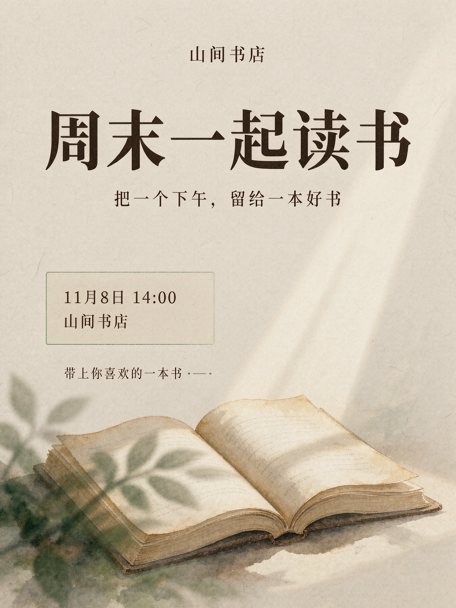
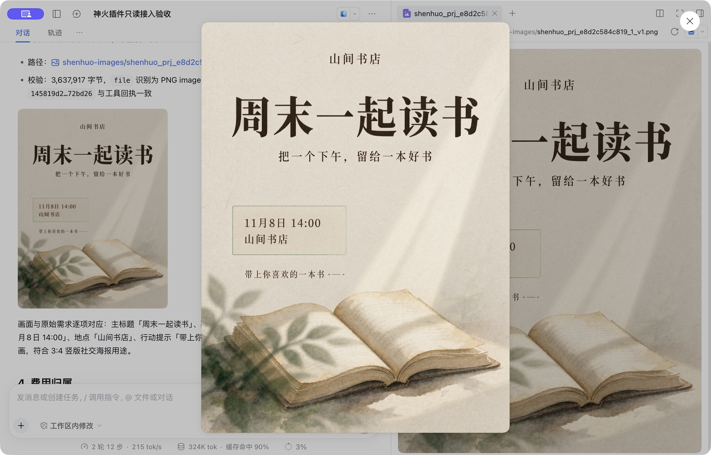

# 神火设计师 · Image Designer

[English](README.en.md)

在 **DeepSeek Harness（DSH）** 中委托神火 AI 设计师完成图片设计。使用神火个人账号 OAuth 和个人积分，从需求与素材开始，经过设计师匹配、必要追问、设计提案和报价确认，生成并下载作品。


## 可以做什么

- 查询实时设计师目录，按公开能力选择设计师，或先匹配再由你选定。
- 上传当前本地工作区的商品图、参考图、人物照片及支持的文档。
- 将完整需求和真实追问回答交给神火设计师，取得整组设计提案。
- 展示积分报价，在你确认后生成图片，持续查询并下载已结算作品。
- 保存任务 ID 和幂等记录，授权恢复、连接中断或下载失败后继续原任务。

可用领域包含电商、海报、社交配图、品牌、办公和人像等，以实时目录为准。设计判断、提示词和图片生成由神火服务完成。本插件提供 DSH 接入，不需要安装本地图片模型。

## 真实交付示例

下图是本插件 MCP 客户端完成提案、报价确认、生图和下载后得到的真实作品：虚构“山间书店”读书会海报，`1344×1792`、Pro / 1.5K。另在 DSH 桌面会话中验证了原任务恢复、下载和图片展示。提案回执为 20 积分，生图回执为 50 积分；这只是本例的实际结算，当前任务以实时报价为准。



在 DSH 中恢复原任务并展示同一张作品：



## 安装

要求：DSH `0.2.1-rc.5` 起的兼容版本，Node.js `24.9+`。使用本机 DSH；远程／SSH 工作区不在首版文件传输支持范围内。

**从插件市场安装**：已向 [awesome-dsh-plugin 提交收录 PR #10821](https://github.com/awesome-dsh-plugin/awesome-dsh-plugin/pull/10821)，目前等待审核及新仓库年龄门槛。收录并更新目录后，可在使用该目录的市场中搜索“神火”或 `dsh-image-designer`。尚未收录时请使用下面的直接安装方式。

**DSH 桌面版**：打开“插件 → 添加插件”，输入：

```text
github:chenyth/dsh-image-designer
```

安装后点击“立即启用”。如需固定版本，可使用 [Releases](https://github.com/chenyth/dsh-image-designer/releases) 中的预构建 `.tgz` 下载地址作为安装目标。

**DSH CLI**：

```bash
dsh plugin --profile web add github:chenyth/dsh-image-designer
```

之后重新启动该 profile。Electron 管理的 `desktop` profile 请使用桌面版插件管理器。

## 开始使用

1. 还没有神火账号，先[注册神火 AI](https://www.shenhuoai.com/register)。新账号赠送积分以实际账户回执为准。
2. 在 DSH 输入 `/shenhuo-designers`，或说“使用神火设计师”。首次使用时打开 `shenhuo_connect` 返回的链接，在运行 DSH 的同一台电脑浏览器内登录并授权。
3. 返回 DSH 回复“已授权”，插件会核验账号、加载业务工具并继续需求。

示例：

```text
使用神火设计师，用工作区 products/coffee.png 设计一组咖啡电商主图。
品牌名“山间咖啡”，突出低温烘焙和坚果风味，请先匹配合适的设计师。
```

```text
使用神火的运营海报设计师，制作“周末一起读书”读书会海报。
时间11月8日14:00，地点山间书店，风格温暖安静。先给我提案和报价。
```

匹配与提案可能消费个人积分，提交需求后执行。生图另行展示有效报价，你确认后才提交。默认规格和张数由神火设计师解析；明确数量或规格请写在原始需求中。

积分不足时，使用当前绑定的同一账号[在官网充值](https://www.shenhuoai.com/home/recharge)，回来回复“已充值，继续生成”。插件核验余额、恢复原项目并重新报价，不重复建项。

## 界面语言

插件名称和介绍跟随 DSH 的界面语言：中文显示“神火设计师”，英文显示“Image Designer”。在 DSH 的“设置 → 通用 → 语言”中切换，名称和介绍会使用对应语言；其他语言按 DSH 的语言回退规则显示。技术包名始终为 `dsh-image-designer`。

## 文件与任务恢复

素材放在当前**本地工作区**内；插件以原始字节上传并核对哈希。工作区外的文件先复制到工作区。下载默认保存到 `shenhuo-images/`，已有同名文件会保留并加序号，成功后返回真实绝对路径和 SHA-256。远程服务器不能直接读取你电脑上的路径。

生成中会按服务端要求持续等待和查询；部分成功会先交付已结算作品并说明未完成部分。票据过期只重新领取文件，不重新生图。断线或新会话可要求“恢复神火任务”，插件通过 `shenhuo_resume` 读取当前账号记录，再查询真实状态。

历史费用、本轮新增费用和生图预估分别以服务端回执为准；恢复历史任务不代表重新消费。官网原项目链接使用服务端返回地址。

## 隐私与授权

业务仅连接神火官方 HTTPS MCP，文件仅使用官方短期传输票据。OAuth 令牌不进入模型参数；不需要填写 API Key、密码或邀请代码。

本机状态默认位于 `~/.dsh-image-designer/`，目录权限 `0700`、JSON 文件权限 `0600`。其中包含个人 OAuth 凭证和恢复所需的原始操作参数／需求。请勿上传、同步到公开仓库或分享整个目录。可通过 `DSH_IMAGE_DESIGNER_DATA_DIR` 或插件 `dataDir` 配置独立本机目录。

在神火个人账号的“已连接应用”中可撤销授权。卸载插件停止本机接入，已在神火创建的项目和作品仍由神火保存；重新授权后可继续查询。

## 当前范围

首版提供新建设计流程。不提供已有作品修改、重生成、图层编辑或本机模型调用。公开模型档位和最终交付物以服务返回为准，不承诺矢量、印前源文件或任意张数免费。Windows 和远程工作区状态见 [验收记录](docs/acceptance.md)。

## 开发与自检

```bash
npm ci --ignore-scripts
npm test
npm run doctor
npm pack
```

`doctor` 检查官方 OAuth 发现；已授权时还会核验账号并发现 MCP 工具，不调用匹配、提案或生图。代码是可直接执行的 ESM，安装时无需构建。

公共流程来自神火主仓库的 `plugin-mcp` 模板，来源摘要在 [runtime-source.json](docs/runtime-source.json)。本仓库维护 DSH 适配代码，公共流程更新由主仓库渲染后同步。

[神火 AI 官网](https://www.shenhuoai.com) · [问题反馈](https://github.com/chenyth/dsh-image-designer/issues) · [MIT License](LICENSE)
